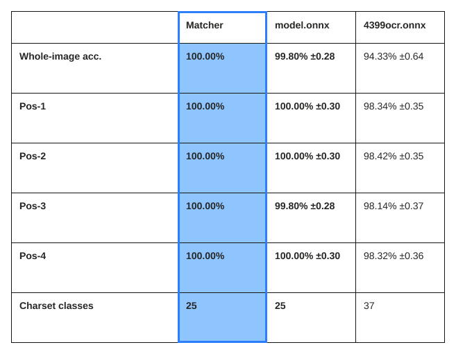

# 4399 验证码识别


这个[溜溜梅](https://en.wikipedia.org/wiki/Large_language_model)生成的克苏鲁产物可以100%识别 `ptlogin.4399.com` 的验证码。onnx模型是用matcher识别完之后训练出来的。


## 起因


本来是想要训一个onnx但是人工输验证码太麻烦还容易错，在0个[普朗克时间](https://zh.wikipedia.org/wiki/%E6%99%AE%E6%9C%97%E5%85%8B%E6%99%82%E9%96%93)后发现4399的验证码字母样子居然完全不会变。这个现象使我[蒙古](https://zh.wikipedia.org/wiki/%E8%92%99%E5%8F%A4%E5%9B%BD)。

于是我向[溜溜梅](https://en.wikipedia.org/wiki/Large_language_model)许愿给我生成一个正确率100%的产物。再让那个去顺带训了一下onnx。下面是跟这个项目([OxygenNEL-OpenNELOCR](https://github.com/MC20018/OxygenNEL-OpenNELOCR))的对比。




## 用法

### matcher

```bash
./releases/matcher.exe 验证码.jpg       # 输出 4 个字符，一行
CFD6
```

一次一张，单线程，只支持 JPEG。
Linux 用 `releases/matcher-linux-x86_64`（真静态 ELF，零依赖），aarch64 同理。

### model.onnx

见下面「ONNX 模型：配置与用法」，那段里有一份复制就能跑的完整代码。

## 文件

| 文件 | 说明 |
|---|---|
| `matcher.c` | 识别器 |
| `glyphs.png` | 模板图 |
| `templates.h` | 字形坐标表 |
| `stb_image.h` | JPEG 解码（[nothings/stb](https://github.com/nothings/stb)，公有领域 / MIT） |
| `model/model.onnx` | 神经网络权重（ONNX，CPU 推理） |
| `model/model.json` | 神经网络配置：字符集、结构参数、输入尺寸、训练与验证成绩 |
---

## ONNX 模型：配置与用法


```
输入   image    (batch, 3, 30, 60)  float32
输出   p0..p3   各 (batch, 25)      float32
```

架构和权重全都烘在 `model.onnx` 里了，**不需要任何配套配置就能加载**。
但有两个常量在外边，不写出来推不出来：**字符集顺序**和**预处理**。
前者在 `model/model.json` 里，后者就是下面这几行。

`model/model.json` 的字段：

| 字段 | 值 | 说明 |
|---|---|---|
| `charset` | `23467ACDEFGHJKMNPQRTUVWXY` | 25 个字符，索引 = 输出那一维的下标 |
| `seq_len` | `4` | 4 位验证码，对应 4 个输出头 |
| `num_classes` | `25` | 每个输出头的宽度 |
| `img_h` / `img_w` | `30` / `60` | 输入尺寸 |
| `widths` | `[16, 32, 64, 96]` | 分段池化的 4 段宽度（4 个槽位各管一段） |
| `seg_hidden` | `64` | 每个槽位自己的特征宽度 |
| `dropout` | `0.2` | 训练时的 dropout（推理无效） |
| `trained_on` | `8099` | 训练集张数 |
| `val_n` / `val_exact` / `val_per_pos` | `1911` / `0.9979` / `[…]` | 留出集的验证成绩 |

### 预处理

```python
a = np.asarray(im.convert("RGB"), dtype=np.float32) / 255.0
a = (a - 0.5) / 0.5                      # 等价于 /127.5 - 1
x = a.transpose(2, 0, 1)[None]           # (1, 3, 30, 60)
```

1. **保持 RGB，不要转灰度** —— 每个字符颜色不同，叠字时颜色是最强的分离线索
2. **不要缩放**，原图就是 60×30；喂别的尺寸会直接掉到 ~0%
3. 输出是 4 个**各自独立**的 25 类 logits，不是 CTC：
   **每位各自 argmax 再查 charset**，不需要合并重复、也不用去 blank

### 完整可跑的代码

```python
import json
import numpy as np
import onnxruntime as ort
from PIL import Image

cfg = json.load(open("model/model.json", encoding="utf-8"))
sess = ort.InferenceSession("model/model.onnx",
                            providers=["CPUExecutionProvider"])

im = Image.open("验证码.jpg").convert("RGB")          # 彩色，别转灰度
a = np.asarray(im, dtype=np.float32) / 255.0
a = (a - 0.5) / 0.5
x = a.transpose(2, 0, 1)[None]                        # (1, 3, 30, 60)

outs = sess.run(None, {"image": x})                   # 4 个 (1, 25)
label = "".join(cfg["charset"][int(o[0].argmax())] for o in outs)
print(label)
```

依赖：`pip install onnxruntime numpy pillow`。


## 编译

自己去编译去。


## 声明

作者不为这个克苏鲁产物负任何责任。如果它帮到了你，那它帮到了你。你可以顺便点一个star。


## 许可证

见 [LICENSE](LICENSE)：**MIT**。嗯对需要标注作者名，虽然我只手写了README.md。但是如果你拿着这个东西忽悠人去圈钱。那我只能祝你自拍下就是全家福了。

`stb_image.h` 是公有领域 / MIT（[nothings/stb](https://github.com/nothings/stb)），
只用于构建，不改变本项目的许可证。
